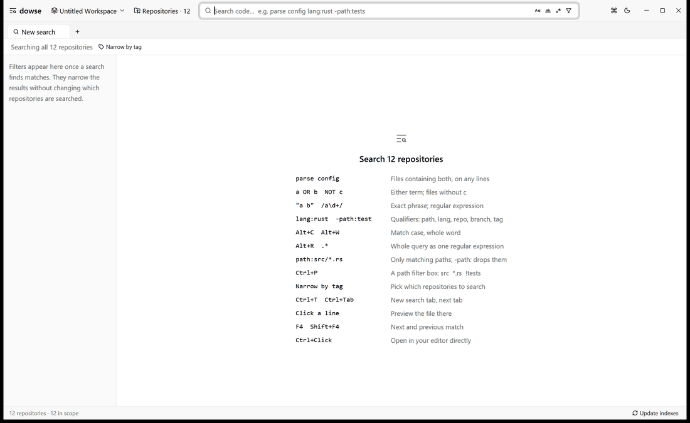

<div align="center">

<h1>
  <picture>
    <source media="(prefers-color-scheme: dark)" srcset="docs/brand/dowse-wordmark-dark.svg">
    
  </picture>
</h1>

<p><strong>一站式秒级检索本地磁盘中的所有代码仓库</strong></p>

<p><a href="README.md">English</a> &nbsp;·&nbsp; <strong>简体中文</strong></p>

</div>

面向多代码仓库的高性能本地代码搜索工具，兼具桌面 GUI 与命令行两种形态。它带来媲美 [grep.app](https://grep.app) 和 GitHub 代码搜索的极速体验，且完全运行于本地磁盘：无论是常驻 `main` 分支的团队镜像，还是日常开发中的本地工作副本均可即时检索。dowse 底层采用基于 [tgrep](https://github.com/microsoft/tgrep) 的 Trigram 倒排索引作为核心检索引擎，并基于 [GPUI](https://github.com/zed-industries/zed)（[GPUI Kit](https://gpui-kit.com)）打造了 GPU 硬件加速的高响应度桌面界面。



实测 12 个公开开源仓库、45,629 个文件：输入即刻呈现搜索结果，点击 Facet 筛选标签秒级收窄到 Rust 语言，切换表格模式更可按行规整呈现每条匹配。

## 核心特性

- **海量仓库，一框检索。** 支持添加单个仓库或包含多个子仓库的父目录。支持类似 VS Code 的多窗口工作区管理，并可通过 `mirror`、`owner:alice` 或 `branch:main` 等标签灵活划定搜索范围。[详见桌面应用指南](docs/zh-CN/app.md)
- **兼容 GitHub 语法，即输即搜。** 支持 `parse config lang:rust -path:tests`、精确短语匹配、正则表达式与布尔逻辑运算（`AND`、`OR`、`NOT`），并可通过仓库、分支、标签、编程语言及目录等多维度 Facet 标签快速收窄。[详见搜索语法指南](docs/zh-CN/search.md)
- **匹配片段与结构化表格双重视图。** 正则捕获组可自动提取为独立的表格列，支持一键导出为 CSV、TSV、Markdown 或 JSON。内置侧边预览面板无需唤起外部编辑器，毫秒级即时渲染完整文件。[详见结果展示](docs/zh-CN/app.md#结果展示代码片段与表格视图)
- **镜像仓库后台自动同步。** 支持通过 GitHub CLI（`gh`）批量克隆指定用户或组织名下的所有仓库；支持后台定时自动拉取，仅在满足安全条件时执行快进合并（Fast-forward），绝不干扰本地未提交的代码修改。[详见克隆与同步](docs/zh-CN/app.md#从-github-克隆仓库)
- **实时同步的 Trigram 索引。** 索引格式与 `tgrep` 命令行原生兼容；支持增量构建，仅重新处理变更文件，配合后台文件监听器（File Watcher），代码在编辑器中一经保存即可被立即检索。[详见索引机制](docs/zh-CN/indexes.md)
- **面向开发者与 AI 编程助手协同设计。** `dowse search` 命令行通过本地 IPC 与正在运行的桌面应用共享常驻内存热索引。CLI 输出严格控制 Token 消耗，在截断时主动通过 stderr 推荐收窄限定符，并内置专为 Agent 设计的交互指南（`dowse guide`）。[详见命令行参考](docs/zh-CN/cli.md) 与 [Agent 使用指南](docs/zh-CN/agent-guide.md)
- **内置安全自动更新。** 运行期间每日自动检测 GitHub Releases，校验官方发布的 SHA-256 校验和并完成就地原子替换升级。[详见安装指南](docs/zh-CN/install.md#自动与手动更新)

## 快速上手

### 桌面应用

1. **启动并添加仓库**：启动 `dowse`，按下快捷键 `Ctrl+O`（macOS 为 `Cmd+O`），或直接将文件夹拖拽至应用窗口中。
2. **实时搜索**：输入诸如 `parse config lang:rust -path:tests` 的查询词。点击任意匹配行可在右侧即时预览；按 `Alt+T`（macOS 为 `Cmd+Alt+T`）切换为结构化表格视图。
3. **管理与打标**：打开仓库管理页面（`Ctrl+,`），为仓库添加自定义标签，在结果上方范围栏中灵活勾选要搜索的仓库子集。

### 命令行

```bash
# 在已配置的所有仓库中检索
dowse search 'parse_config lang:rust'

# 仅检索当前终端工作目录所在的仓库
dowse search --here 'parse_config'

# 查看所有已索引仓库及其分支、文件统计
dowse repos

# 查看面向 AI Coding Agent 的使用指南
dowse guide
```

在应用内随时按下 `Ctrl+K`（macOS 为 `Cmd+K`）即可呼出全局命令面板（Command Palette），查看全部功能及其对应快捷键。

## 安装与下载

前往 [GitHub Releases](https://github.com/HenryZhang-ZHY/dowse/releases/latest) 下载对应平台的预编译安装包：

| 平台                                  | 压缩包                                | 说明                                                                                                                            |
| ------------------------------------- | ------------------------------------- | ------------------------------------------------------------------------------------------------------------------------------- |
| **Windows (x64)**                     | `dowse-<version>-windows-x86_64.zip`  | 包含 `dowse.exe`（GUI 主程序）与 `dowse.com`（CLI 控制台入口）。解压至任意目录并添加至环境变量 `PATH`。                         |
| **macOS 11+** (Apple Silicon / Intel) | `dowse-<version>-macos-universal.zip` | 通用架构 `dowse.app`。解压后拖入 `/Applications`。终端使用可将 `/Applications/dowse.app/Contents/MacOS/dowse` 软链接至 `PATH`。 |
| **Linux** (x64 / arm64)               | `dowse-<version>-linux-<arch>.tar.gz` | 单一二进制文件，兼具 GUI 与 CLI 功能。需要 glibc 2.35+（Ubuntu 22.04+、Debian 12+、Fedora 36+）及 Vulkan 图形驱动支持。           |

由于开源构建未购买商业代码签名证书，初次运行时操作系统可能会弹出安全警告。详细的系统放行说明、环境变量配置及源码编译步骤，请参阅 [安装与更新指南](docs/zh-CN/install.md)。

## 文档导航

完整文档可在 [文档中心（Documentation Hub）](docs/zh-CN/README.md) 中查阅：

| 文档                                               | 内容说明                                                |
| -------------------------------------------------- | ------------------------------------------------------- |
| [文档中心](docs/zh-CN/README.md)                   | 全局文档目录索引、学习路线与高频快捷键速查              |
| [安装与更新](docs/zh-CN/install.md)                | 运行环境要求、下载安装、后台自动更新与源码编译指南      |
| [桌面应用](docs/zh-CN/app.md)                      | 工作区概念、仓库管理、多标签页、表格导出与快捷键        |
| [搜索语法](docs/zh-CN/search.md)                   | GitHub 兼容语法规则、路径漏斗过滤器与内部执行流水线     |
| [索引机制](docs/zh-CN/indexes.md)                  | Trigram 索引原理、索引存放位置与增量更新机制            |
| [命令行工具](docs/zh-CN/cli.md)                    | 全部 CLI 子命令详解、JSON/表格结构化输出与 IPC 架构     |
| [AI Agent 编码助手指南](docs/zh-CN/agent-guide.md) | 面向大模型编码助手的最佳实践与设计哲学（`dowse guide`） |
| [架构与开发](docs/zh-CN/development.md)            | 项目源码结构、模块划分、单元测试与发布流程              |

## 开源协议

本项目采用 [MIT 许可证](LICENSE)。
